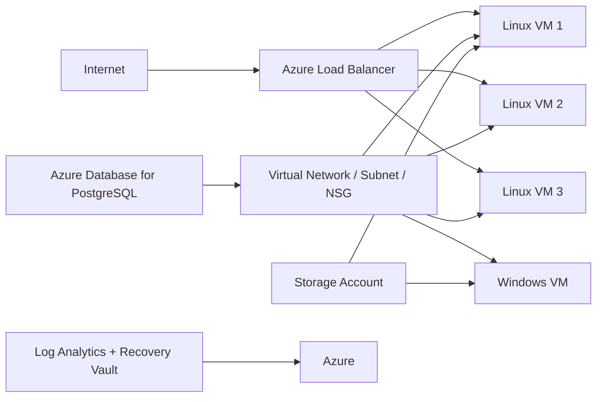

# Azure Terraform Infrastructure Deployment

This repository contains an Azure infrastructure-as-code deployment built with Terraform for a multi-tier lab environment. The project provisions a secure network foundation, application compute resources, monitoring services, a database, and supporting platform services in a single Azure subscription.

The configuration is organized into reusable Terraform modules and follows a modular architecture that is suitable for learning, prototyping, and infrastructure standardization.

## Overview

The environment is designed to simulate a practical Azure landing zone with:

- a dedicated resource group
- a virtual network and subnet
- a network security group with inbound access rules
- three Linux virtual machines distributed across Azure Availability Zones 1, 2, and 3
- a Windows virtual machine placed in Availability Zone 1
- a public load balancer for the Linux tier
- Azure storage and monitoring services
- a PostgreSQL Flexible Server database

This setup is representative of a simple enterprise application deployment and demonstrates how Terraform can manage Azure resources consistently and repeatably.

## Architecture



## Included Azure Resources

### Network layer
- Resource Group
- Virtual Network: N10038841-VNET
- Subnet: N10038841-SUBNET
- Network Security Group with inbound rules for:
  - SSH (22)
  - HTTP (80)
  - RDP (3389)
  - WinRM / PowerShell Remoting (5985)

### Compute layer
- 3 Linux VMs based on CentOS 8 Gen2, placed in Zones 1, 2, and 3
- 1 Windows Server 2022 VM placed in Zone 1
- Zonal VM placement is used for VM fault isolation instead of attaching VMs to availability sets
- Public IPs assigned to each VM for access and connectivity validation, with zonal public IP configuration
- Azure Load Balancer with a frontend public IP and backend pool for Linux VMs

### Observability and platform services
- Log Analytics Workspace
- Recovery Services Vault
- Storage Account for boot diagnostics and platform support
- Azure Monitor and Network Watcher extensions on Linux VMs
- Antimalware extension on the Windows VM

### Data layer
- PostgreSQL Flexible Server instance running PostgreSQL 16
- Public network access enabled for lab access

## Repository Structure

```text
Terraform_Project/
├── backend.tf
├── locals.tf
├── main.tf
├── outputs.tf
├── providers.tf
├── README.md
├── project-N10038841/
│   ├── common-N10038841/
│   ├── database-N10038841/
│   ├── datadisk-N10038841/
│   ├── loadbalancer-N10038841/
│   ├── network-N10038841/
│   ├── rgroup-N10038841/
│   ├── vmlinux-N10038841/
│   └── vmwindows-N10038841/
└── ...
```

## Modules

The deployment is split into separate modules for logical separation and maintainability:

- rgroup-N10038841: Resource group creation
- network-N10038841: VNet, subnet, and NSG
- common-N10038841: Log Analytics, Recovery Vault, and Storage Account
- vmlinux-N10038841: Linux VM infrastructure and extensions
- vmwindows-N10038841: Windows VM infrastructure and security extension
- datadisk-N10038841: Data disk attachment across VM resources
- loadbalancer-N10038841: Public load balancer and backend association
- database-N10038841: PostgreSQL Flexible Server deployment

## Prerequisites

Before deploying, ensure the following are in place:

- Azure subscription with permission to create resources
- Terraform installed locally
- Azure CLI installed and authenticated
- An SSH public key available at ~/.ssh/id_rsa.pub
- A subscription selected in your Azure context

### Authenticate to Azure

```bash
az login
az account set --subscription "<your-subscription-id>"
```

## Deployment Steps

1. Clone the repository and navigate to the project directory.

```bash
git clone <repository-url>
cd Terraform_Project
```

2. Initialize Terraform.

```bash
terraform init
```

3. Review the execution plan.

```bash
terraform plan
```

4. Apply the configuration.

```bash
terraform apply
```

5. Confirm the created resources in the Azure portal or by using Terraform outputs.

## Outputs

The root module exposes key deployment outputs, including:

- resource group name
- virtual network name
- subnet name
- Linux VM hostnames and public IPs
- Windows VM hostnames and public IPs
- load balancer details
- PostgreSQL server name

These outputs are useful for validation, connectivity checks, and later operational workflows.

## Configuration Notes

- The project uses the AzureRM provider with a fixed subscription ID in the provider configuration.
- Resource names are intentionally prefixed with the project identifier N10038841.
- Linux VMs are assigned explicit Azure zone values in the `locals.tf` map and the VM resources use the `zone` attribute to place each VM in a specific availability zone.
- The Windows VM uses `zone = count.index + 1` so it deploys into Zone 1 in the current configuration.
- Availability zones and availability sets are not used together on the same VM; Azure requires either zonal placement or an availability set, not both.
- The environment uses Azure region values aligned to the project design, with the database deployed in Canada Central.
- Tags are applied for ownership, project identification, environment classification, and expiration tracking.

## Security Considerations

This repository is structured for a learning or lab environment and is intentionally simple for demonstration purposes. In a production setting, the following should be implemented:

- store secrets in Azure Key Vault instead of hardcoding credentials
- use protected variable files or CI/CD secret management
- restrict public access using network controls and security policies
- enable centralized monitoring, alerting, and logging
- validate least-privilege RBAC assignments

## Teardown

To remove all infrastructure created by this project:

```bash
terraform destroy
```

## Summary

This Terraform project demonstrates a complete Azure deployment pattern for a lab or proof-of-concept environment. It covers core infrastructure concerns such as networking, availability, identity and access patterns, monitoring, storage, database services, and modular code organization—all key practices in cloud engineering.

The project is suitable as a foundation for further enhancement into production-ready patterns such as modular environments, remote state, CI/CD automation, and policy enforcement.
